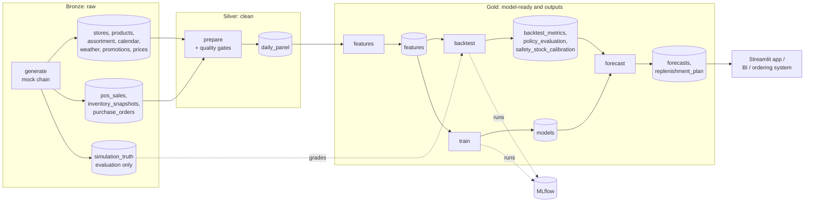
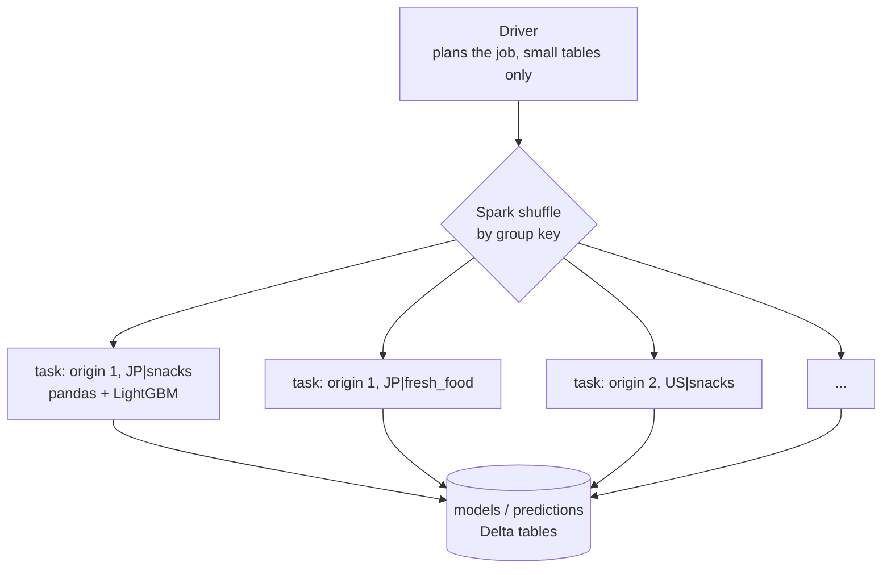
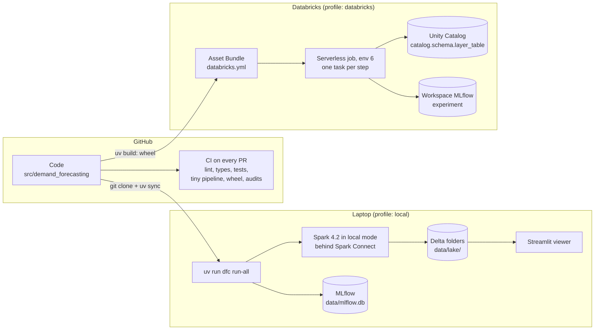

# Architecture

## The pipeline at a glance



Each box is one CLI sub-command (`uv run dfc <step>`) and one Databricks job task. Every step reads its
inputs from tables and writes its outputs to tables, so any step can be rerun on its own.

## Code layout

```
src/demand_forecasting/
  cli.py            `dfc` entry point: one sub-command per step, `run-all`
  config.py         typed settings: presets, profiles (resources/*.toml), CLI overrides
  spark.py          Spark session: Databricks' own, or local Spark Connect + Delta
  storage.py        logical table names -> Delta paths or Unity Catalog tables
  tracking.py       MLflow helpers (same code locally and on Databricks)
  domain.py         the chain's vocabulary: countries, formats, aisles, categories
  data/             mock data: world.py (dimensions), simulate.py (one store), generate.py (step)
  pipeline/         prepare, quality, features, censoring, model, training, metrics,
                    replenish, backtest, train, forecast
  resources/        local.toml, databricks.toml, ivysettings.xml
app/streamlit_app.py  results viewer (reads Delta directly; no Spark needed)
databricks.yml, resources/demand_forecasting.yml   Databricks Asset Bundle
tests/              unit, Spark-level and end-to-end tests
```

Rule of thumb: `model.py`, `censoring.py`, `world.py` and `simulate.py` are pure pandas/numpy and know
nothing about Spark; the step modules (`generate`, `prepare`, `features`, `backtest`, `train`, `forecast`)
orchestrate Spark around them.

## How the work is distributed



| Work | Parallel unit | Spark API |
|---|---|---|
| Simulate the chain | one store | `groupBy("store_id").applyInPandas` |
| Features, joins, metrics, policy | rows | DataFrame API, window functions |
| Train | one (cut-off, model group) | `groupBy(...).applyInPandas` |
| Score | one (cut-off, model group) with its models | `groupBy(...).cogroup(...).applyInPandas` |

The **model group** (default `country x aisle`, optionally split by a hash of the store) is the scaling knob.
Before training, the pipeline checks that the largest group stays under `forecast.max_rows_per_group`
(1.5 million rows by default), because Databricks serverless limits each pandas task to 1 GB of memory.

## Local vs. Databricks

One codebase, two places to run it. GitHub CI checks every change before it can reach `main`;
the same code then runs on a laptop through `uv`, or on Databricks as a wheel inside a serverless job.



| Concern | Local (`--profile local`) | Databricks (`--profile databricks`) |
|---|---|---|
| Spark | `local[*]` behind Spark Connect, Delta 4.4 jars from Maven Central | the job's serverless session |
| Tables | Delta folders under `data/lake/` | Unity Catalog `<catalog>.<schema>.<layer>_<table>` |
| MLflow | SQLite `data/mlflow.db`, artifacts in `data/mlruns/` | workspace experiment created by the bundle |
| Orchestration | `uv run dfc run-all` | bundle job with one task per step |
| Packaging | editable install via `uv sync` | wheel built by `uv build`, installed in serverless environment 6 |
| Python / Spark | 3.12 / 4.2.0 (pinned) | 3.12.3 / Databricks Runtime 19 (Spark 4.2) |

Only `spark.py` and `storage.py` look at the profile. See [decisions/0001](decisions/0001-local-first-mirroring-serverless.md)
and [databricks-migration.md](databricks-migration.md).
